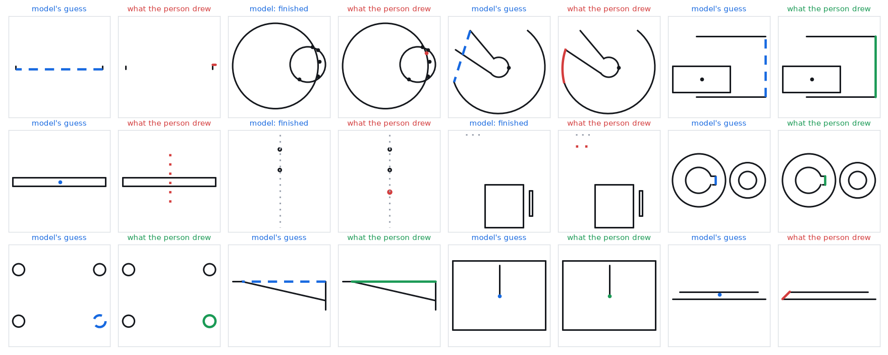
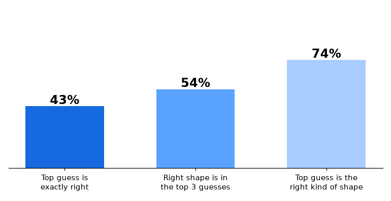
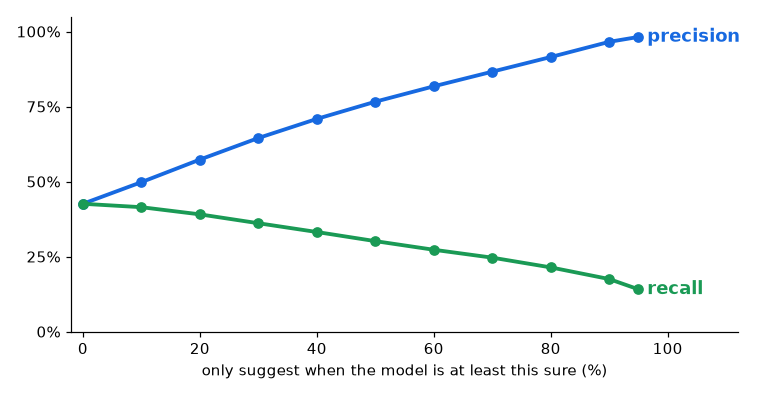
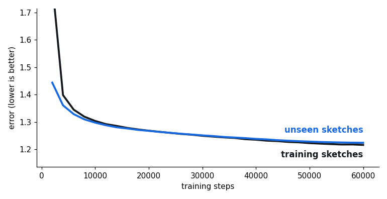

# Sketch autocomplete

Draw a sketch; a small model guesses the next shape. It runs in the browser, with no server.



*Twelve test sketches picked at random. Left of each pair: the model's guess (dashed). Right: what the person drew
(green = the guess matched, red = it did not).*



Tested on 5,000 sketches the model never saw (31,859 hidden shapes).



Show a guess only when the model is sure, and more of the shown guesses are right.



## How it works

| | |
|---|---|
| Data | [SketchGraphs](https://github.com/PrincetonLIPS/SketchGraphs): 9.2 million sketches, 2.5 million after removing copies |
| Tokens | each shape = its kind + positions on a 64 x 64 grid (`tokens.py`) |
| Model | a 4.8-million-weight GPT, written out in `model.py` and again in plain JavaScript (`web/model.js`) |
| Training | 60,000 steps, 72 minutes on one RTX 4090, about $1.64 (`train.py`) |
| Page | `web/` — open `web/index.html` through any static server |

## Run it

```
python prep.py DATA_DIR TOKENS_DIR                 # SketchGraphs sg_t16_*.npy -> token rows
python train.py TOKENS_DIR RUN_DIR --steps 60000
python evaluate.py TOKENS_DIR RUN_DIR/best.pt RUN_DIR/eval.json 5000
python export.py RUN_DIR/best.pt TOKENS_DIR web/   # weights for the page
node test/parity.mjs                               # the page's model must match PyTorch
python build_page.py && python -m http.server --directory web
```

Everything that was done, including what went wrong, is in [docs/build-log.md](docs/build-log.md).
The sketches belong to the people who drew them (public Onshape documents); this repo holds code and a trained model, not the data.
